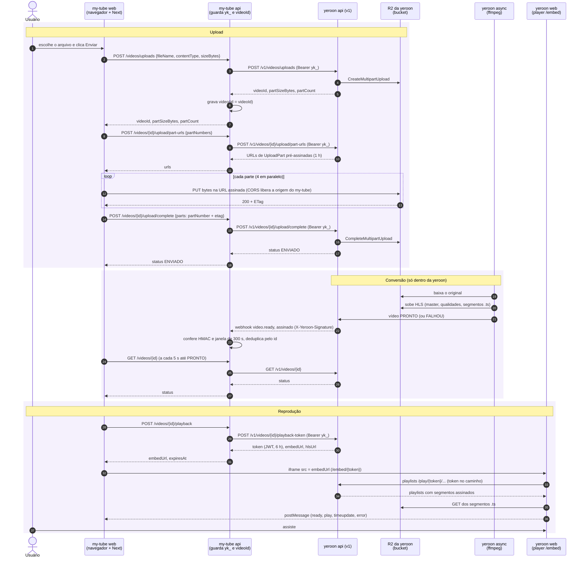

# my-tube

Monorepo: `my-tube-api` (Spring Boot, entrada HTTP), `my-tube-core`
(application/domain/infrastructure), `buildingBlocks` (contratos base),
`my-tube-web` (Next.js) e `my-tube-mobile` (Expo). Convenções em
[docs/superpowers/INSTRUCTIONS.md](docs/superpowers/INSTRUCTIONS.md).

`make help` lista os alvos. `make run` sobe o Postgres, a api (`:8080`) e o web
(`:3000`); o mobile roda à parte com `make run-mobile`.

## Instalação

Os vídeos são hospedados pela **yeroon play** (API v1 em
`https://api.dev.play.yeroon.video`). Sem a chave dela, o app sobe, mas
a lista responde "Não foi possível carregar os vídeos.".

### 1. Requisitos

| Ferramenta | Versão | Para quê |
|---|---|---|
| JDK | 25 | api e core (o Gradle Wrapper vem no repo) |
| Node.js | 20.9 ou mais nova | web e mobile |
| Docker | com `docker compose` | Postgres local e testes de integração |
| `make`, `curl`, `jq` | — | alvos do Makefile e cadastro na yeroon |

As portas `5432`, `8080` e `3000` precisam estar livres. Se outro projeto
local estiver usando alguma delas (por exemplo, o `yeroon-play`), pare-o
antes.

### 2. Dependências e banco

```bash
make install   # npm ci do web e do mobile
make up        # Postgres em Docker; as migrations rodam quando a api sobe
```

### 3. Chave da yeroon play (uma vez)

O administrador da yeroon cadastra o my-tube como cliente. A resposta
traz a `apiKey` (`yk_…`) e o `webhookSecret` (`whsec_…`), e é a **única vez**
em que esses valores aparecem. Grave a resposta direto num arquivo, assim os
valores não passam pela tela nem ficam no histórico do shell:

```bash
curl -sS -X POST https://api.dev.play.yeroon.video/admin/tenants \
  -H "X-Admin-Token: $(cat ~/.yeroon-admin-token)" \
  -H "Content-Type: application/json" \
  -d '{"name":"my-tube","allowedOrigins":["http://localhost:3000"]}' \
  -o ~/.my-tube-yeroon.json -w '%{http_code}\n' && chmod 600 ~/.my-tube-yeroon.json
```

A saída esperada é `201`. Rode **uma vez só**, porque cada chamada cria outro
cliente. Depois, gere o `.env` na raiz do repositório (ele está no
`.gitignore`):

```bash
jq -r '"YEROON_API_KEY=\(.apiKey)\nYEROON_WEBHOOK_SECRET=\(.webhookSecret)"' \
  ~/.my-tube-yeroon.json > .env && chmod 600 .env
```

O `allowedOrigins` é a origem que pode embutir o player. Se o web rodar em
outro endereço, cadastre esse endereço.

### 4. Subir

O Makefile não lê o `.env`. Exporte-o no shell antes de subir:

```bash
set -a; . ./.env; set +a
make run
```

### 5. Conferir

```bash
curl -s localhost:8080/actuator/health   # {"status":"UP"...}
curl -s localhost:3000/api/videos        # {"videos":[...]}, não 502
```

Abra http://localhost:3000 e envie um vídeo pelo botão **Enviar vídeo**. A
conferência completa, cobrindo upload, retomada, reprodução e falhas, está no
runbook [docs/checkpoints/yeroon-play-plugado.md](docs/checkpoints/yeroon-play-plugado.md).

### Problemas comuns

| Sintoma | Causa provável |
|---|---|
| `/api/videos` responde 502 e o log da api mostra `WARN YEROON_API_KEY ... esta vazia` | O `.env` não foi exportado no shell do `make run`. |
| `/api/videos` responde 502 e o log mostra `ERROR yeroon recusou a chave de API (status 401)` | A chave está errada ou o cliente foi recriado. Refaça o passo 3. |
| `/api/videos` responde 502 e o log mostra `WARN yeroon indisponivel (...)` | A yeroon está fora do ar, em deploy, ou o `YEROON_API_URL` está errado. |
| O `PUT` das partes falha por CORS no navegador | A origem do web não está no CORS do bucket R2 da yeroon. |
| O player não abre no iframe | A origem do web não está nas `allowedOrigins` do cadastro. |
| Erro de porta em uso | Outro projeto ocupa a `5432`, a `8080` ou a `3000`. |

## Integração com a yeroon play

Como um app se integra à yeroon play depois de ter a chave e o cadastro
(Instalação, passo 3). O contrato completo da API é o `docs/api/v1.md` do
repositório `bjjdream/yeroon-play`. Cada passo abaixo aponta onde o
my-tube implementa a integração, para servir de modelo.

### Quem é quem

| Peça | Dono | Onde roda | O que faz |
|---|---|---|---|
| **my-tube web** | my-tube | Navegador + servidor Next (`:3000`) | Telas. Os Route Handlers `/api/videos/**` repassam ao my-tube api |
| **my-tube api** | my-tube | Spring Boot (`:8080`) | Guarda a chave `yk_` e só o `videoId`. Chama a v1 da yeroon e recebe o webhook |
| **yeroon api (v1)** | yeroon play | `https://api.dev.play.yeroon.video` | Cria o upload, assina as URLs das partes, emite o token de reprodução e manda o webhook |
| **R2 da yeroon** | yeroon play | bucket `yeroon-play-bucket-dev` no Cloudflare R2 | Guarda o original e o HLS. É **da yeroon**, não do my-tube |
| **yeroon async** | yeroon play | VPS da yeroon | Converte o original em HLS com ffmpeg |
| **yeroon web (player)** | yeroon play | `https://play.dev.yeroon.video` | Página `/embed/{token}` que o iframe abre |

Nas seções abaixo, **"seu back"** é o my-tube api e **"seu front"** é
o my-tube web. Tudo o que é `/v1/...` é a yeroon.

### Como o navegador grava no R2 da yeroon sem ter credencial

Sim: o upload vai **direto do navegador para o R2 da yeroon**. Nem o
my-tube api nem a yeroon api recebem os bytes do vídeo. Isso funciona
com **URL pré-assinada** (presigned URL do S3):

1. O my-tube api chama `POST /v1/videos/uploads`. A yeroon api abre um
   *multipart upload* no R2 dela (`CreateMultipartUpload`) e devolve o
   `videoId`, o tamanho de cada parte e quantas partes são.
2. O my-tube api chama `POST /v1/videos/{id}/upload/part-urls`. A
   yeroon api, que tem as credenciais do R2, gera para cada parte uma URL de
   `UploadPart` **assinada**. A assinatura vale 1 h, só para aquele objeto,
   aquele upload e aquele número de parte. A URL é
   `https://<conta>.r2.cloudflarestorage.com/yeroon-play-bucket-dev/originais/<videoId>?partNumber=N&uploadId=…&X-Amz-Signature=…`.
3. O navegador faz `PUT` nessa URL com os bytes da parte. O R2 confere a
   assinatura, aceita e devolve o `ETag`. Quem autoriza é a assinatura na
   própria URL, então o navegador não precisa de chave nenhuma.
4. Para o navegador poder fazer esse `PUT` e ler o `ETag`, o **CORS do bucket
   da yeroon** libera a origem do my-tube web (`http://localhost:3000`)
   com `PUT` e `ExposeHeaders: ETag`. Uma origem nova precisa ser pedida ao
   administrador da yeroon.
5. O `complete` (`CompleteMultipartUpload`) junta as partes no R2. A partir
   daí, a conversão e o HLS ficam todos dentro da yeroon.

A reprodução segue a mesma ideia. O player da yeroon lê as playlists pela
yeroon api, e os segmentos `.ts` vêm do R2 da yeroon por URLs GET assinadas.

### O fluxo completo



Sem `webhookUrl` cadastrado, como no ambiente local, o passo do webhook não
acontece. O status continua chegando pela consulta `GET /videos/{id}`.

**Três regras valem para tudo:**

1. **A chave `yk_` fica só no my-tube api.** O navegador nunca a
   recebe: ele fala com o servidor Next do my-tube, que repassa ao
   my-tube api, que chama a v1 da yeroon.
2. **O my-tube guarda só o `videoId`.** Arquivo, status, qualidades e
   mídia ficam na yeroon. Leia o status da v1 quando precisar mostrá-lo.
3. **Os bytes não passam por nenhum back.** O navegador faz o `PUT` das partes
   direto no R2 da yeroon, pelas URLs assinadas que a v1 devolve.

### Back (my-tube api)

**1. Cliente da v1.** Faça um cliente HTTP com
`Authorization: Bearer ${YEROON_API_KEY}` e base
`https://api.dev.play.yeroon.video`. Converta as respostas de erro da
v1 assim:

| v1 | Seu back responde | Exceção no my-tube |
|---|---|---|
| 422 (`errors[{code,message}]`) | 422 com os mesmos `errors` | `YeroonRejectedException` |
| 404 | 404, sem repetir o id | `YeroonNotFoundException` |
| 409 (vídeo ainda não pronto) | 409 | `YeroonConflictException` |
| 401, 403, 5xx ou falha de rede | 502 genérico, e a chave nunca no log | `YeroonUnavailableException` |

Modelo: `infrastructure/data/anticorruptionLayer/yeroon/YeroonClient.java`
(interface) e `.../impl/YeroonClientImpl.java` no `-core`.

**2. Rotas de upload** (todas repassam à v1 com a chave):

| Sua rota | Chama na v1 | Observação |
|---|---|---|
| `POST /videos/uploads` | `POST /v1/videos/uploads` | Grava o `videoId` devolvido na sua tabela |
| `POST /videos/{id}/upload/part-urls` | `POST /v1/videos/{id}/upload/part-urls` | Até 20 números de parte por chamada |
| `GET /videos/{id}/upload/parts` | `GET /v1/videos/{id}/upload/parts` | Partes já enviadas; é o que permite retomar |
| `POST /videos/{id}/upload/complete` | `POST /v1/videos/{id}/upload/complete` | Corpo `{parts:[{partNumber,etag}]}` |
| `DELETE /videos/{id}/upload` | `DELETE /v1/videos/{id}/upload` | Cancela |

Antes de chamar a v1, confira que o `id` está na sua tabela. Se não estiver,
responda 404 sem chamar a v1. Assim ninguém usa o seu back para alcançar
vídeo de outro cliente. Modelo: `presenter/routes/video/*` no `-api` e
`application/video/*` no `-core`.

**3. Consulta.** `GET /v1/videos` lista os vídeos do cliente; filtre pelos ids
da sua tabela. `GET /v1/videos/{id}` devolve status, `failureReason` e
miniatura. Status possíveis: `PENDENTE`, `ENVIADO`, `PROCESSANDO`, `PRONTO`,
`FALHOU`, `CANCELADO` e `ABANDONADO`.

**4. Reprodução.** `POST /v1/videos/{id}/playback-token` só funciona com o
vídeo `PRONTO`; antes disso, responde 409. Devolva ao front **só** o
`embedUrl` e o `expiresAt`, com `Cache-Control: no-store`. O token vale 6 h:
peça um novo a cada abertura da página e não guarde. Modelo:
`IssuePlaybackRoute`.

**5. Webhook.** Exponha `POST /webhooks/yeroon` e informe a URL pública no
cadastro (`webhookUrl`). Em cada aviso:

1. Leia o **corpo bruto**, antes de qualquer parse.
2. Confira `X-Yeroon-Signature: t=<epoch>,v1=<hex>`: calcule
   `hex(HMAC-SHA256(YEROON_WEBHOOK_SECRET, "<epoch>.<corpo bruto>"))` e
   compare com `v1` em **tempo constante**.
3. Recuse com 401 se a assinatura não bater, se o `epoch` estiver a mais de
   300 s do relógio ou se o segredo não estiver configurado.
4. Deduplique pelo `id` do corpo, que é o mesmo valor do `X-Yeroon-Delivery`
   e vem coberto pela assinatura. Um aviso repetido responde 200 sem
   reprocessar.
5. Responda 2xx rápido (até 10 s). Fora isso, a yeroon reenvia com espera
   crescente, até 8 vezes.

```java
String esperado = HexFormat.of().formatHex(hmacSha256(secret, t + "." + rawBody));
boolean ok = MessageDigest.isEqual(esperado.getBytes(UTF_8), v1.getBytes(UTF_8))
        && Math.abs(now - t) <= 300;
```

Modelo: `presenter/configuration/security/YeroonWebhookSignature.java` e
`presenter/routes/webhook/receiveYeroonWebhook/ReceiveYeroonWebhookRoute.java`.

### Front (my-tube web)

**1. Rotas do próprio front.** O navegador fala só com o seu servidor. No
Next, cada Route Handler em `src/app/api/videos/**` repassa ao back
(`src/lib/repasse.ts`, com `MY_TUBE_API_URL`). O único outro destino do
navegador é o R2, no `PUT` das partes.

**2. Upload em partes, com retomada** (`src/lib/upload.ts`):

1. Chame `POST /api/videos/uploads` com `{fileName, contentType, sizeBytes}`
   e guarde no `localStorage` o `videoId` e o tamanho da parte. A chave é
   `upload:<nome>:<tamanho>:<lastModified>` do arquivo.
2. Peça as URLs em lotes de até 20 (`part-urls`) e envie as partes com
   `file.slice((n-1)*partSize, n*partSize)`, 4 de cada vez. Cada parte faz
   até 4 tentativas: a primeira e mais 3, com espera de 0,5 s, 1 s e 2 s
   entre elas.
3. Mande o `PUT` com `content-type: application/octet-stream`. Da resposta,
   leia o cabeçalho `ETag`; ele vai para o `complete`.
4. Ao escolher o mesmo arquivo de novo, consulte `GET .../upload/parts` e
   envie só o que falta. Se a resposta for 404 ou 422, apague o estado salvo
   e comece do zero.
5. Termine com `POST .../upload/complete` e limpe o `localStorage`.

O bucket R2 da yeroon precisa liberar a origem do seu front no CORS (`PUT`,
`ExposeHeaders: ETag`). Para uma origem nova, peça ao administrador da
yeroon.

**3. Player** (`src/components/VideoDetail.tsx`). Enquanto o status não for
`PRONTO`, mostre o status e consulte de novo (por exemplo, a cada 5 s). Pare
de consultar em `PRONTO`, `FALHOU`, `CANCELADO` e `ABANDONADO`. Com o vídeo
pronto, peça o `embedUrl` ao seu back e abra:

```tsx
<iframe src={embedUrl} title="Player"
        allow="autoplay; fullscreen; picture-in-picture" allowFullScreen />
```

O player só abre nas `allowedOrigins` do cadastro. Num app nativo, toque o
`hlsUrl` que o `playback-token` também devolve (por exemplo, com
`expo-video`). O back do my-tube hoje repassa só o `embedUrl`; para o
mobile, ele precisa repassar o `hlsUrl` também.

**4. Eventos do player (`postMessage`).** Aceite só mensagens da origem do
`embedUrl` e com `source: "yeroon-player"`:

```ts
const origin = new URL(embedUrl).origin;
window.addEventListener("message", (e) => {
  if (e.origin !== origin || e.data?.source !== "yeroon-player") return;
  // e.data.type: "ready" | "play" | "pause" | "timeupdate" | "ended" | "error"
  // e.data.currentTime, e.data.duration, e.data.videoId
});
```

O `timeupdate` chega no máximo uma vez por segundo de vídeo, o que basta para
acompanhar o progresso de aula. Para comandar o player:

```ts
iframe.contentWindow?.postMessage(
  { source: "yeroon-host", command: "seek", value: 120 }, origin);
// command: "play" | "pause" | "seek" (value em segundos) | "mute" | "unmute"
```

## Variáveis de ambiente

Lidas por `my-tube-api/src/main/resources/application.properties`; os
padrões moram lá.

```
YEROON_API_URL=
YEROON_API_KEY=
YEROON_WEBHOOK_SECRET=
```

O web (`my-tube-web`) lê `MY_TUBE_API_URL` (padrão `http://localhost:8080`),
o endereço do `-api` para onde seus Route Handlers repassam:

```
MY_TUBE_API_URL=
```

## Testes

| Comando | O que roda |
|---|---|
| `make test-backend` | `./gradlew test`: testes unitários, sem banco |
| `make test-integration` | `./gradlew integrationTest`: classes `*IT` sobre Postgres em Testcontainers (precisa de Docker) |
| `make test-mutation` | `./gradlew :my-tube-core:pitest`: teste de mutação dos unitários do `-core`; diagnóstico, fora do `make test` |
| `make test-web` | lint, `typecheck` e Vitest do `my-tube-web` |
| `make test-mobile` | `typecheck` e jest-expo do `my-tube-mobile` |
| `make test` | todos acima, menos o de mutação |

Os testes de integração moram em `my-tube-integration-tests/`, todos
estendendo `support/BaseIntegrationTest`. A regra
`architecture/EntrypointHasIntegrationTestIT` exige um `<Nome>IT` para todo
entrypoint (`@RestController`, método `@Scheduled`, …).
